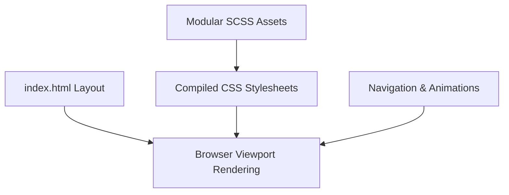

<p align="center">
  
</p>

<p align="center">
    
</p>


## 📌 Table of Contents
- [📖 Executive Summary](#-executive-summary)
- [✨ Key Features & Capabilities](#-key-features--capabilities)
- [🏗️ System Architecture & Workflow](#️-system-architecture--workflow)
- [🛠️ Tech Stack Breakdown](#️-tech-stack-breakdown)
- [⚙️ Reproducible Quickstart & Setup](#️-reproducible-quickstart--setup)
- [📂 Project Directory Layout](#-project-directory-layout)
- [👩‍💻 Author & Contributions](#-author--contributions)

---

## 📖 Executive Summary
### Problem Statement
Software engineers require clean, fast-loading, mobile-first web templates to effectively showcase technical projects, experience, and contact channels.

### Motivation & Solution Overview
A lightweight, responsive web portfolio built with modular SCSS styling, FontAwesome iconography, responsive grids, and clean JavaScript navigation.

---

## ✨ Key Features & Capabilities
- **Mobile-Responsive:** Adaptive styling across desktop, tablet, and mobile viewport widths.
- **SCSS Architecture:** Modular stylesheets for maintainable visual theming.
- **Iconography & Typography:** FontAwesome vector icons and optimized web typography.

---

## 🏗️ System Architecture & Workflow


---

## 🛠️ Tech Stack Breakdown
| Category | Technologies |
|---|---|
| **Structure & Style** | HTML5, SCSS / CSS3, FontAwesome |
| **Scripting** | Vanilla JavaScript |

---

## ⚙️ Reproducible Quickstart & Setup
```bash
git clone https://github.com/Bhumikaravi/portfolio_templates.git
cd portfolio_templates
# Open index.html in any browser:
python -m http.server 8080
```

---

## 📂 Project Directory Layout
```text
portfolio_templates/
├── index.html
├── LICENSE.txt
├── README.txt
├── assets/
│   ├── css/
│   │   ├── main.css
│   │   └── fontawesome-all.min.css
│   └── images/
└── README.md
```

---

## 👩‍💻 Author & Contributions
Developed by **Bhumika Ravi** ([@Bhumikaravi](https://github.com/Bhumikaravi)), Bachelor of Computer Applications (BCA) at **Alliance University, Bengaluru**.

- 💻 **GitHub Profile:** [github.com/Bhumikaravi](https://github.com/Bhumikaravi)
- 🔗 **LinkedIn:** [linkedin.com/in/bhumika-ravi-b5a01b326](https://www.linkedin.com/in/bhumika-ravi-b5a01b326/)
- 📬 **Email Contact:** [bhumikaravi2006@gmail.com](mailto:bhumikaravi2006@gmail.com)

---

<p align="center">
  
</p>
